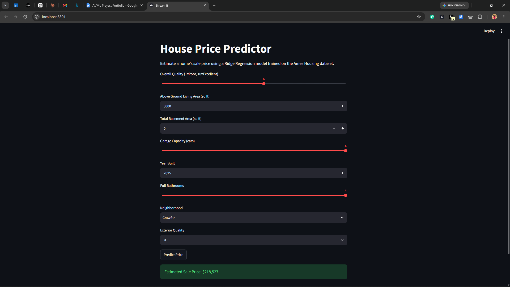

# House Price Predictor

Predicts what a house would sell for based on things like square footage, quality rating, and neighborhood, trained on the Ames Housing dataset (the same one Kaggle uses for its housing competition).

**Live demo:** https://house-price-predictor-inyunbm8dhh25ppfbpnjci.streamlit.app/



## What's going on under the hood

The dataset has 80+ columns and a good number of missing values scattered across it, so most of the actual work here is cleaning: filling in gaps (median for numbers, most common value for categories, and lot frontage specifically gets filled per-neighborhood since lot sizes vary a lot by area), encoding categorical columns, and scaling everything numeric.

**Model:** Ridge Regression. I chose Ridge over plain Linear Regression because the dataset has a lot of correlated features (like total square footage and above-ground living area), and Ridge's regularization keeps the model from overreacting to that overlap. The `alpha` value is tuned automatically with `GridSearchCV` (testing 0.1 through 100, using 5-fold cross-validation) rather than picked by hand, it landed on 100.

One thing that made a real difference: house prices are skewed, so a few very expensive homes were throwing off the error metric more than they should. Training on the log of the price instead of the raw number, then converting predictions back afterward, fixed that.

Ends up at an RMSE of about $27,900 and an R² of 0.899.

## Why the demo only asks for 8 things

Nobody's filling out an 80-field form to get a price estimate. The app asks for the 8 features that actually move the needle such as quality, size, garage, year built, bathrooms, neighborhood, exterior quality and quietly fills in the rest using the same defaults the model was trained with.

## Running it yourself
```
git clone https://github.com/olarewajumary/house-price-predictor
cd house-price-predictor
python -m venv venv
venv\Scripts\activate
pip install -r requirements.txt
python main.py
streamlit run app.py
```

`main.py` trains the model and saves it; `app.py` is the actual interface.

## Built with

Python, pandas, scikit-learn, Streamlit, FastAPI, Docker, GitHub Actions

## Turning it into a real service

The Streamlit app is a nice demo, but nothing else can talk to it. So I wrapped the same trained model in a FastAPI service and added the things that make it something you could actually deploy: tests, a Docker container, and a CI pipeline that runs on every push.

There are two endpoints. `POST /predict` takes the same 8 features as the demo and sends back a price. `GET /health` just says everything's fine, which is what hosting platforms ping to check a service is alive.

## Bad input doesn't crash it

Every request gets checked before it reaches the model, so a quality score of 11 comes back with a clear error instead of a stack trace. Testing also turned up a hole: a made-up neighborhood slipped past that first check and crashed the encoder with a 500. I wrote a test that reproduced it, watched it fail, then fixed it so it returns a 422 like any other bad input.

## Tests and CI

There are 4 tests: one on the prediction function and three that go through the API, including the bad-input cases. On every push, GitHub Actions lints the code, runs the tests, and builds the Docker image on a clean machine.

To make sure the pipeline actually does something, I broke a test on purpose and pushed it. CI went red, I fixed it, and it went green again. Both runs are still in the Actions tab.

## Try it

It's live, so you can skip the setup and try it right now: https://house-price-api-uzm1.onrender.com/docs

That page lets you send it a house and see the price come back. One thing to know: it's on a free plan that goes to sleep when nobody's using it, so the first request after a quiet spell can take up to a minute while it wakes up. After that it's quick.

To run it yourself:

```
pip install -r requirements-api.txt
uvicorn service.api:app
```

Then open http://127.0.0.1:8000/docs for an interactive page where you can send it a house.

Or in Docker:

```
docker build --load -t house-price-api .
docker run -p 8000:8000 house-price-api
```

## How fast, how reliable

Every request is logged as one line of JSON (method, path, status, how long it took), and the numbers below come from those logs. The location of the model files can be changed with an `ARTIFACTS_DIR` environment variable, so nothing is hard-coded.

I sent it 120 requests from my own Windows laptop, 100 good ones and 20 bad ones, one after another. It had zero server errors, rejected all 20 bad requests cleanly, and `/predict` answered in about 91 ms in the middle. 95% of requests finished in under 156 ms.

That's one person on one laptop, not a real production load, so read it as "it behaves well" and not "it scales." The scripts are in `scripts/` if you want to run it yourself.